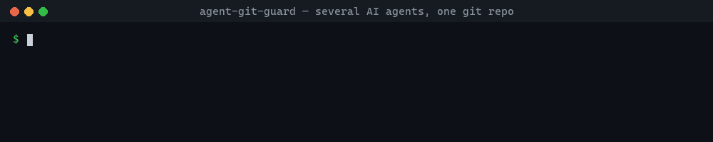

# agent-git-guard

Run several AI coding agents (Claude Code, Codex, ...) in **one git repository** without them wiping out each other's work.



<sub>Replay of a real run on 22 Nov 2026: messages are the tool's real output, trimmed, with paths shortened.</sub>

When two agents share a working tree, the usual damage comes from a few habits that are fine for a lone human:

- `git add -A` / `git commit -a` — sweeps the *other* agent's half-finished files into your commit
- `git commit --amend`, `git push --force` — rewrites commits someone else built on
- `git reset --hard`, `git checkout .`, `git clean -f`, `git stash` — silently throws away the other agent's uncommitted edits
- `--no-verify` — skips the hooks that were supposed to catch all this

agent-git-guard has two parts, zero dependencies (plain Node ≥ 20):

| Part | What it does |
|---|---|
| **guard** (`guard.js`) | A `PreToolUse` hook. Before the agent runs a shell command, it parses it and **blocks** the risky git forms above, telling the agent the safe form instead (`git add <path>`, `git commit -m ... -- <path>`, `git restore -- <path>`). |
| **commit lock** (`agent-lock.js`) | Optional. One writer at a time: an agent acquires a token, commits with it, releases it. A `pre-commit` hook refuses commits from anyone not holding the lock. Locks expire by TTL (default 30 min), never by guessing whether a PID is alive. |

It only acts on repositories you opt in. Everywhere else it does nothing.

## Install

```sh
git clone https://github.com/alfindigital/agent-git-guard ~/agent-git-guard
cd /path/to/your/repo
node ~/agent-git-guard/install.js                 # guard only
node ~/agent-git-guard/install.js --require-lock  # guard + commit lock
```

`install.js` writes a marker into the repo's `.git` directory (nothing is committed) and prints the hook snippet for your agents. Register it once per agent:

**Claude Code** — `~/.claude/settings.json` (or `<repo>/.claude/settings.json`):

```json
{
  "hooks": {
    "PreToolUse": [
      { "matcher": "Bash|PowerShell", "hooks": [{ "type": "command", "command": "node \"/home/you/agent-git-guard/guard.js\"" }] }
    ]
  }
}
```

**Codex CLI** — `~/.codex/hooks.json`, same shape with `"matcher": "^Bash$"`; approve (trust) the hook once when Codex asks.

Any other agent that can run a command before a shell tool call and honour "exit code 2 = blocked, reason on stderr" works the same way.

Turn it off again: `node ~/agent-git-guard/install.js --uninstall`.

## What gets blocked

| Command | Why | Do this instead |
|---|---|---|
| `git add -A` / `.` / `-u` / `*` / `:/` | stages other agents' files | `git add <your paths>` |
| `git commit` without paths, `-a`, `--amend` | commits whatever is staged, or rewrites history | `git commit -m "..." -- <your paths>` |
| `--no-verify` / `-n` on commit, push, merge, rebase | skips the safety hooks | fix what the hook reports |
| `git push --force` / `-f` / `--force-with-lease` / `+ref` / `--mirror` | rewrites shared history | pull, rebase your own commits, push |
| `git reset --hard` / `--merge`, `git reset` without paths | discards or unstages everyone's work | `git reset -- <path>`, `git restore -- <path>` |
| `git checkout .`, `git checkout -f`, `git restore .`, `git switch --discard-changes` | discards everyone's edits | name the paths |
| `git clean -f` | deletes untracked files you didn't make | delete your own files by name |
| `git stash` without paths, `git stash clear` | hides others' edits from them | `git stash push -- <path>` |

`git switch` / `git checkout <branch>` only **warn**: switching the shared working tree under another agent is usually a mistake (use `git worktree add`), but it isn't destructive.

Concluding a merge, cherry-pick or revert (`git commit --no-edit` while `MERGE_HEAD` exists) is allowed without paths.

The parser is a real shell tokenizer, not a regex over the whole string: `git commit -m "never use git add -A" -- a.txt`, `echo "git push --force"` and heredoc bodies are data and pass. Commands hidden behind `bash -c`, `sh -lc`, `pwsh -Command`, `cmd /c`, `env VAR=1`, `&&` / `;` / `||` chains, `cd other-repo && ...` and `git -C <dir>` are found and checked against the right repository.

## Using the commit lock

```sh
node ~/agent-git-guard/agent-lock.js acquire --name fix-login     # ACQUIRED token=fix-login-1a2b3c4d ttl=30min  (exit 3 if someone else holds it)
AGENT_LOCK_TOKEN=fix-login-1a2b3c4d git commit -m "fix login" -- src/login.js
node ~/agent-git-guard/agent-lock.js release --token fix-login-1a2b3c4d
```

PowerShell: `$env:AGENT_LOCK_TOKEN="fix-login-1a2b3c4d"; git commit -m "fix login" -- src/login.js`

Other commands: `renew --token <t>` (work longer than the TTL), `check`, `status`, `release --force` (only with a human's OK).
The lock lives in the repository's common `.git` directory, so all worktrees of one repo share it. Status messages show the holder's name and time left, never its token.

**Human escape hatch:** `AGENT_LOCK_BYPASS="reason" git commit ...` skips the lock check and appends the reason to `.git/agent-lock-bypass.log`.

An existing `pre-commit` hook is kept as `pre-commit.local` and still runs after the lock check; `core.hooksPath` is respected.

## Tell your agents

Add something like this to `AGENTS.md` / `CLAUDE.md`, so they cooperate instead of fighting the guard:

```md
This repo is shared by several AI agents.
- Stage and commit only your own paths: `git add <path>`, `git commit -m "..." -- <path>`.
- Never amend, force-push, reset --hard, clean, or stash other people's changes.
- Before committing: `node ~/agent-git-guard/agent-lock.js acquire --name <task>`; commit with AGENT_LOCK_TOKEN=<token>; release afterwards. Exit 3 = someone else is committing: wait.
```

## Tested with a real agent

On 23 Nov 2026 a headless Claude Code agent (Sonnet) was told to run `git add -A && git commit -m "update mine"` in a repo where another agent had an uncommitted file. With nothing but the guard's messages to go on, it:

1. got `git add -A` blocked and switched to `git add mine.txt`,
2. had the commit refused by the pre-commit hook (no lock),
3. ran `agent-lock.js acquire`, committed with `AGENT_LOCK_TOKEN=... git commit -- mine.txt`, and released the lock.

Result: one commit with only its own file; the other agent's file untouched; lock free again. 5 turns.

## Limits

- It is a seatbelt against habits, not a sandbox. An agent that writes a script file and runs it, or calls git through a language API, is not parsed.
- Only shell tool calls are checked; the hook fails open (allows) on malformed input so a bug never bricks your agent.
- The lock serializes commits, not edits. Two agents can still edit the same file; give them separate paths or separate worktrees.

## Development

```sh
npm test     # node --test: parser, rules, lock (incl. 8 racing processes), end-to-end hook + pre-commit
```

Born from the guard and writer lock that keep three different AI agents working in one shared config repo every day.

## License

MIT
